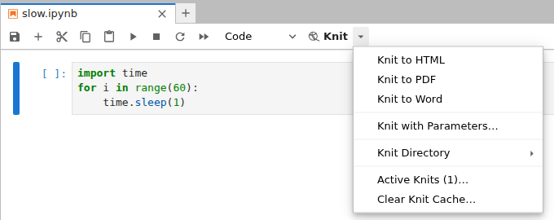
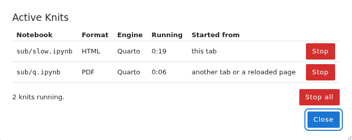

# jupyterlab-knit: an RStudio-style Knit button for JupyterLab

A JupyterLab 4 extension that brings the R Markdown **Knit** workflow to Python notebooks. One click (or `Ctrl+Shift+K`) saves the notebook, runs it from top to bottom in a fresh process and renders it to HTML, PDF or Word with [Quarto](https://quarto.org), then shows the result next to the notebook. It installs in user space, needs no administrator rights and works on JupyterHub.

## Overview

Exporting a notebook from JupyterLab saves whatever the open kernel has produced, including outputs from cells run out of order or edited afterwards. Knitting in RStudio is different: the document is executed from scratch in a new session, so the report can only contain what the code actually produces. This extension reproduces that guarantee and the RStudio interface around it:

- **Fresh execution** : the notebook is rendered in a separate process from a new kernel; the interactive kernel and the open notebook are never touched
- **Knit ▾ split button** : the same menu as RStudio, with Knit to HTML / PDF / Word, Knit with Parameters, Knit Directory and Clear Knit Cache
- **YAML header** : output options live in a raw first cell, exactly like the header of an `.Rmd` file, and choosing a format from the menu moves it to the top of `format:` as RStudio does with `output:`
- **Render pane** : a live log of the render with a Stop button, like RStudio's Render tab
- **Active Knits** : every running knit of the user, from any tab or from before a page reload, with Stop per knit and Stop all
- **Preview** : HTML and PDF open beside the notebook and reload on every knit



## Features

| Menu entry | What it does |
|---|---|
| **Knit** (button, `Ctrl+Shift+K`) | Renders with the first format listed in the header, HTML if the notebook has none |
| **Knit to HTML / PDF / Word** | Moves that format to the top of the header (creating the header if needed) and renders it |
| **Knit with Parameters…** | Shows a form with one field per assignment in the cell tagged `parameters` and renders with the values entered |
| **Knit Directory** ▸ Document / Project | Runs the code with the notebook's folder or the server root as working directory; remembered per notebook |
| **Active Knits…** | Lists every running knit (notebook, format, engine, elapsed time, where it was started) with Stop and Stop all |
| **Clear Knit Cache…** | Deletes the execution cache (`.jupyter_cache`) in the notebook's folder |

Further behaviour:

- **Long lines in PDF** : when Knit to PDF creates the `pdf:` entry of the header it adds [fvextra](https://ctan.org/pkg/fvextra) line wrapping, so long code and printed output stay on the page
- **Wide tables in PDF** : the same entry references `wide-tables.lua`, a Lua filter that fits wide tables (for example pandas DataFrames) to the page by wrapping headers and reducing the font; the filter is written next to the notebook on the first PDF knit and never overwritten
- **Existing settings are respected** : a `pdf:` entry you already have is never modified, and comments in the header are preserved
- **One render per notebook** : a second knit of the same notebook, from any tab, is refused with a pointer to Active Knits
- **Clean failure** : a failed or stopped render never replaces the previous output; the error is summarised in a notification and the full log stays in the Render pane
- **Fallback** : without Quarto, Knit to HTML still works through `nbconvert`



## Requirements

| Component | Needed for | Installation |
|---|---|---|
| JupyterLab 4.x | everything | already on your server |
| `python3` kernel with `nbconvert` | everything (launches the render) | usually already installed |
| [Quarto](https://quarto.org) | PDF, Word, parameters, Project Directory; recommended for HTML | `install_quarto.sh` |
| [TinyTeX](https://yihui.org/tinytex/) | Knit to PDF | `install_tinytex.sh` |
| [papermill](https://papermill.readthedocs.io) | Knit with Parameters | `python -m pip install papermill` |
| [jupyter-cache](https://jupyter-cache.readthedocs.io) | `execute: cache: true` and Clear Knit Cache | `python -m pip install jupyter-cache` |

Each notebook still runs on the kernel recorded in its own metadata, so notebooks using other environments render in those environments.

## Installation

All steps run in a terminal on the Jupyter server (on JupyterHub: **File → New → Terminal**). No administrator rights are needed.

1. Download `jupyterlab-knit-<version>.tar.gz` from the [Releases](../../releases) page and extract it:
   ```bash
   tar xzf jupyterlab-knit-<version>.tar.gz
   cd jupyterlab-knit
   ```
2. Install Quarto (optional, recommended). It goes to `~/opt/quarto-<version>` with a link in `~/.local/bin`; running the script again skips the download, and a specific release can be passed as an argument:
   ```bash
   bash install_quarto.sh            # latest release
   bash install_quarto.sh 1.10.18    # or a pinned one
   ```
3. Install TinyTeX for PDF output (optional, about 200 MB). Missing LaTeX packages are downloaded automatically during the first PDF knits:
   ```bash
   bash install_tinytex.sh
   ```
4. Install the extension. It is copied to `~/.local/share/jupyter/labextensions/`:
   ```bash
   bash install.sh
   ```
5. Restart your server (on JupyterHub: **File → Hub Control Panel → Stop My Server → Start My Server**) and reload the page. A **Knit ▾** button appears in every notebook toolbar.

To update, repeat step 4 with the new release and restart the server. To uninstall, delete `~/.local/share/jupyter/labextensions/jupyterlab-knit` and restart.

## Usage

### The header

Put the YAML header in a **raw** first cell (cell type *Raw* in the toolbar), as you would at the top of an `.Rmd` file:

```yaml
---
title: "Analysis report"
author: "Your Name"
date: today
format:
  html:
    toc: true
    code-fold: true
    embed-resources: true
  pdf: default
execute:
  warning: false
---
```

The Knit button renders the first format listed (`html` here). Picking **Knit to PDF** from the menu moves `pdf` to the top, so the next plain Knit produces a PDF too. Without a header, Knit renders HTML.

### Cell options

Cell options use Quarto syntax at the top of a code cell and work like knitr chunk options:

| Option | Effect |
|---|---|
| `#| echo: false` | Output only, code hidden |
| `#| include: false` | Cell runs, nothing appears in the report |
| `#| eval: false` | Code shown, not run |
| `#| warning: false` | Warnings hidden |
| `#| fig-cap: "..."` | Figure caption |

### Parameters

Tag the cell that defines the parameters with `parameters` (**Property Inspector → Cell Tags**), for example:

```python
alpha = 0.05
cohort = "all"
```

**Knit with Parameters…** shows one field per assignment, pre-filled with the current values, and renders with the values entered; the notebook itself is not changed.

### Outputs

The report is written next to the notebook with the same name (`analysis.ipynb` → `analysis.html`, `.pdf` or `.docx`) and replaces the previous version only when the render succeeds. HTML and PDF open in a split pane beside the notebook; Word files get a **Download** button in the notification. In the in-Lab HTML viewer, interactive figures and the table of contents sidebar need **Trust HTML**, or open the report with **Open in browser tab**.

During a render a temporary copy named `<name>__knit.ipynb` appears in the folder: Quarto writes executed outputs back into the notebook it renders, so a copy is rendered and the open notebook is left untouched. It is removed when the render ends.

### Stopping a render

- **Stop Render** in the Render pane stops the render started from the current tab
- After closing the pane, the same command is available from the command palette (`Ctrl+Shift+C`, category *Knit*)
- After reloading the page or from another tab, **Stop Render** finds the render of the current notebook wherever it was started, and **Active Knits…** lists and stops any of them

Stopping ends the whole render (Quarto, pandoc, LaTeX and the notebook's kernel) and removes its temporary files.

## How it works

1. The notebook is saved, and a short-lived helper kernel starts in the notebook's folder.
2. The helper copies the notebook and runs `quarto render <copy> --execute --to <format>` in its own process group, streaming the log to the Render pane.
3. The render is recorded in a per-user registry (`~/.local/share/jupyterlab-knit/active/`), which is how Active Knits and Stop Render find it from any page.
4. On success the output is renamed to the notebook's name and previewed; on failure or stop nothing replaces the previous output, and a LaTeX log is kept as `<name>.knit-error.log` when there is one.
5. The helper kernel shuts down; helpers left behind by closed or reloaded pages are cleaned up automatically.

## Repository structure

```
.
├── source/
│   ├── src/
│   │   ├── index.ts        # Plugin: commands, Knit menu, render flow, notifications
│   │   ├── runner.ts       # Helper kernels, control channel, active-render registry access
│   │   ├── scripts.ts      # Python run in the helper kernels (render, list, stop, clear cache)
│   │   ├── ui.ts           # Split button, Render pane, Active Knits dialog, icon
│   │   ├── yaml.ts         # Reading and rewriting the format: entry of the YAML header
│   │   └── filters.ts      # wide-tables.lua, the PDF table-fitting filter
│   ├── style/
│   │   └── index.css       # Button, Render pane and dialog styles
│   ├── package.json
│   └── tsconfig.json
├── docs/                   # Banner and screenshots used in this README
├── install.sh              # Installs the prebuilt extension for the current user
├── install_quarto.sh       # Installs Quarto in user space
├── install_tinytex.sh      # Installs TinyTeX in user space
├── LICENSE
└── README.md
```

The prebuilt extension (`labextension/`) is not in the repository; it is included in the release archive.

## Building from source

Building requires Node.js 20 or later. It can be installed without touching the base environment, for example with conda:

```bash
conda create -n knit-build -c conda-forge nodejs=20 -y
conda activate knit-build
cd source
npm install
npm run build                      # writes source/labextension/
cp -r labextension ../labextension
cd .. && bash install.sh
```

## Troubleshooting

| Problem | Cause and fix |
|---|---|
| No Knit button | The server was not restarted, or the extension is not loaded: run `jupyter labextension list` and look for `jupyterlab-knit ... enabled OK` |
| *Quarto is required for Knit to pdf* | Quarto is not installed: run `install_quarto.sh` |
| *Knit to PDF needs LaTeX* | TinyTeX is not installed: run `install_tinytex.sh` |
| *Knit with Parameters needs papermill* | Install it in the server's Python: `python -m pip install papermill` |
| Code or tables run off the PDF page | The `pdf:` entry predates the wrapping options: delete it and choose **Knit to PDF** once to recreate it |
| *already being knitted from another tab* | A render of the same notebook is running elsewhere: open **Active Knits…** to stop it or wait |
| A `<name>.knit-error.log` file appeared | LaTeX failed; the file holds the full LaTeX log, and is removed by the next successful knit |
| Interactive plots do not show in the preview | Click **Trust HTML** in the viewer toolbar or use **Open in browser tab** |

## Limitations

- Linux servers only: stopping a render relies on process groups and `/proc`
- One render at a time per browser tab, and one per notebook overall
- The in-Lab PDF preview uses the browser's built-in PDF viewer
- Very wide tables (a dozen columns or more) fit the page only at a small font size; transposing them or selecting columns reads better

## Author

- Kevin Del Gaudio

## License

Released under the [MIT License](LICENSE).

## References

- Quarto — [quarto.org](https://quarto.org)
- Xie, Y., Allaire, J. J., Grolemund, G. *R Markdown: The Definitive Guide.* Chapman & Hall/CRC, 2018.
- RStudio IDE (Posit) — the Knit workflow this extension reproduces
- Poore, G. *fvextra: extensions and patches for fancyvrb* — [CTAN](https://ctan.org/pkg/fvextra)
- papermill — [papermill.readthedocs.io](https://papermill.readthedocs.io)
- JupyterLab extension developer guide — [jupyterlab.readthedocs.io](https://jupyterlab.readthedocs.io/en/latest/extension/extension_dev.html)
